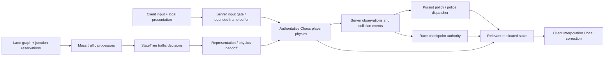

# Architecture

Status: the portable policy layer is implemented. All engine, transport and
world integration described below is a proposed design unless explicitly marked
as authored scaffold. See [STATUS.md](STATUS.md) for the evidence boundary.

## Design drivers

1. Keep competitive outcomes authoritative: the server owns movement acceptance,
   physical collision results, race progression, pursuit heat and police spawning.
2. Scale traffic decisions independently from rigid-body cost. Entity count and
   physical Actor count are different budgets.
3. Make policy changes reproducible without promising deterministic Chaos physics.
4. Prove one city block with two clients before adding district content.

## Intended runtime topology

The delivered executable substitutes integer one-dimensional travel for `P`, a
vector-based lane fixture for `M`, and an in-process snapshot channel for `N`.
It does not implement the rest of this graph. The authored UE component bridges
only the pursuit policy to authority-gated component ticking and replicated fields.

## Module seams and ownership

| Logical module | Inputs | Outputs / owner | Delivery state |
| --- | --- | --- | --- |
| `opl_core` | Integer commands, server observation edges, tick calls | Policy state; no UObject dependency | Implemented |
| `OpenPursuitLab` UE module | Server perception, frame delta | Pursuit fields on an owning replicated Actor | Scaffold authored, unverified |
| Vehicle adapter | Normalized control input, physics callbacks | Chaos pawn transforms, velocity, collision events; server | Planned |
| Traffic runtime | Lane graph, signal phase, reservations, player proximity | Desired controls, LOD handoff requests; server | Planned |
| Police runtime | Server incident stream, last known position, unit budget | Unit assignments and StateTree tasks; server | Planned |
| Race runtime | Swept server transforms and ordered route | Checkpoint index, finish tick, results; server | Planned |
| Networking | Owned inputs, relevancy sets, authoritative state | ACKs, quantized snapshots, correction metrics | Planned |
| Telemetry / tests | Scenario seed, command/event log, engine build ID | Reports, traces, divergence and budget failures | Portable subset implemented |

Keep these as logical seams initially; do not add many empty UE modules. Extract
modules when dependencies and tests justify them. UObject lifetime stays in UE;
the core owns ordinary values only. Events crossing physics/game threads are
immutable records tagged with simulation tick, entity ID and event ID.

## Scheduling and units

The portable model advances only when explicitly stepped at 60 policy ticks per
simulated second. Distance is signed integer millimeters; speed is millimeters
per tick. `500 mm/tick` equals `30 m/s` and is a fixture cap, not a tuned vehicle.
Use explicit conversions at UE boundaries: mm / 10 -> cm, mm/tick * 6 -> cm/s at
60 Hz. Quantization must define rounding and overflow checks.

The intended UE schedule is:

1. Drain validated input and ordered incident edges before the physics step.
2. Run server Chaos physics at a selected 60 Hz configuration; record actual
   substep indices. Validate engine threading behavior in `NET-01`.
3. At 10 Hz, update near traffic decisions and StateTrees. Initially use 5 Hz for
   distant traffic decisions. Lane kinematics advance on the fixed simulation
   clock between decisions; presentation interpolates between states.
4. Resolve server observations, pursuit and swept race checkpoints after physics.
5. Build relevant snapshots at an initial 20 Hz, independent of client render rate.

These rates are design targets, not configured or measured UE behavior. The
component's temporary four-step frame accumulator drops excess time and records
that fact; it must be replaced before G1 acceptance. Production overload handling
must report missed deadlines and degrade traffic work rather than silently
accelerating game time or allowing unbounded catch-up.

## Traffic: MassEntity + StateTree

MassEntity's fragment/processor separation provides the intended data layout.
StateTree provides the decision state structure; both are documented by Epic
([MassEntity](https://dev.epicgames.com/documentation/en-us/unreal-engine/overview-of-mass-entity-in-unreal-engine?application_version=5.6),
[StateTree](https://dev.epicgames.com/documentation/en-us/unreal-engine/overview-of-state-tree-in-unreal-engine?application_version=5.6)).
The following types are design names, not delivered classes:

- `FLaneLocationFragment`: stable logical ID, lane ID, distance along lane.
- `FTrafficMotionFragment`: desired speed, acceleration limits, stop distance.
- `FJunctionReservationFragment`: request tick, junction ID, reservation token.
- `FTrafficDecisionFragment`: FollowLane / Yield / Stop / Recover state and age.
- `FPhysicsHandoffFragment`: Kinematic / Promoting / Physics / Demoting mode,
  ownership epoch and transition tick.

Read-old/write-new lane occupancy avoids order-dependent following. Replace the
portable O(N²) neighbor search with lane-sorted occupancy and nearest-leader
queries. Junction reservations use `(request_tick, logical_id)` as a tie-breaker;
StateTree tasks request a reservation, never mutate shared occupancy directly.
Stuck detection releases reservations and chooses a bounded recovery action.
Mass command buffers apply structural changes after processor iteration, as
described in the [MassEntity overview](https://dev.epicgames.com/documentation/en-us/unreal-engine/overview-of-mass-entity-in-unreal-engine?application_version=5.6).

### Physics handoff invariant

Only one system may write a traffic vehicle's pose in any tick. Planned promotion
within 50 m of a player and demotion beyond 70 m use hysteresis, visibility and
contact checks. An eight-Actor traffic cap is enforced globally, not per player.
Promotion reserves a pooled Actor, copies pose and velocity at a tick boundary,
disables kinematic writes, and increments the representation epoch. Demotion is
forbidden during active contact, then projects the physical vehicle back to a
valid lane before resuming kinematics. If the pool is exhausted, reduce traffic
spawning or hold vehicles at safe lane positions; never create duplicate bodies.

Mass logical IDs survive promotion. Clients must not run an independent traffic
physics authority. Mass representation/replication facilities are candidates,
not assumed automatic vehicle networking; choose the concrete adapter in `AI-03`.

## Pursuit policy

The portable `Pursuit` implementation is the rule oracle for server heat and
alert state. StateTree will drive individual police units' Follow / Intercept /
Search tasks; it must not independently own heat or duplicate the global timers.

| Current state | Guard | Next state / action |
| --- | --- | --- |
| Any | Invalid severity > 3 | Reject before mutation |
| Any | New incident and visible suspect | Heat = max(old, severity), enter Chase |
| Patrol / Cooldown | New incident without visibility | Raise heat, enter Investigate |
| Patrol | Visibility without incident | Remain Patrol |
| Investigate | Visible suspect | Chase |
| Investigate | 120 ticks without visibility | Search |
| Chase | 180 consecutive unseen ticks | Search; visible ticks reset the loss timer |
| Search | Visible suspect | Chase |
| Search | 600 ticks without reacquisition | Cooldown |
| Cooldown | Visible suspect while heat > 0 | Chase |
| Cooldown | 300 ticks without reacquisition | Patrol; clear heat |

Incident handling precedes state timers; visibility precedes timeout transitions.
An unseen incident while already investigating/searching raises heat but does
not reset the timer. Heat tiers are 1..3, with 0 meaning no active incident. Lower
severity cannot reduce heat. The core models no geographic search, police budget,
arrest or dispatch pathfinding. Planned dispatch caps are 1/2/4 units for tiers
1/2/3; steering, interception and safe contact behavior require separate tasks.

Only server perception and validated collision/race-rule events generate
incidents. Give real events IDs and deduplicate them; a held input or an event
replayed after physics resimulation must not raise heat repeatedly.

## Server authority and multiplayer

The delivered `Server` is deliberately narrow: one owner ID, one pending command
for exactly `current_tick + 1`, throttle/brake range checks, monotonic uint32
sequence comparison and a neutral-plus-drag fallback when input is missing.
It accepts no client position, heat, race checkpoint or incident field. Tick wrap
ends the session; sequence wrap uses a strict half-range comparison. It has no
session epoch, input queue, wire protocol, login or real network peer identity.
Its strict tick mailbox would reject normal delayed Internet input; **do not use
it unchanged as a production multiplayer input path**.

Planned input messages contain session epoch, vehicle net ID, sequence, mapped
simulation frame and quantized throttle/brake/steering. Use a bounded decoder,
owner checks from the authenticated connection, per-connection rate limits and
a frame buffer with small bounded input redundancy. The UE spike must choose a
playout delay and future-frame horizon; an initial experiment uses 3 ticks of
playout and a 6-tick future window. Commands arriving after their consumption
deadline are dropped and counted. Disconnects decay to safe neutral/braking.
The server will not rewind the whole world to honor arbitrarily late commands.

Snapshots include epoch, server frame, last processed input sequence, entity ID,
position/orientation/velocity, representation epoch, pursuit tier and race state.
Fields require explicit encoding and versioning; never serialize the native C++
struct layout. Race results and police spawns originate on the server. Remote
vehicles use interpolation; the locally owned car needs prediction/correction
with bounded history. Late join requires a complete authoritative baseline before
incremental snapshots. Reconnect uses a new epoch so stale packets cannot revive
old state.

Epic offers several [networked physics modes](https://dev.epicgames.com/documentation/en-us/unreal-engine/networked-physics-overview?application_version=5.6).
The intended experiment compares owner resimulation against simpler authoritative
replication, with predictive interpolation for relevant remote physics Actors.
Selection is gated on two-car collision tests at 80/150 ms RTT. Enabling a mode
alone is not evidence of working Chaos vehicle prediction. If owner correction
quality fails, keep the experiment at G1 and report it rather than claim lockstep.

The portable `Observer` is just a last-newer-snapshot consumer. It trusts its
server source. `SnapshotLink` introduces one-way delay of 3..15 ticks (50..250 ms)
in the default demo, not a measured Internet RTT. It does not model upstream
input, bandwidth queues, TCP/UDP behavior, smoothing or client physics.

## Race authority

The portable race is one forward-only 1 km lap with crossings at 250/500/750/1000 m.
The server derives crossings from its bounded travel; duplicate or out-of-order
crossings do not increment progress. The public `Race` helper expects consecutive
server movement samples and is not itself an anti-cheat boundary.

The UE version must use swept authoritative transforms against ordered checkpoint
volumes and direction gates, count each crossing once by tick/event ID, and stamp
finish time from the server simulation clock. Respawn invalidates the current
segment and applies an explicit race penalty. Client overlap events can support
UI feedback but cannot award progress.

## Determinism, evidence and limits

Integer policy logic, seeded xorshift32 and a canonical byte-order hash support
repeatable local regression. `replay_digest` covers every fixture tick and traffic
state; the known seed-2026 baseline is `28b84a5f94c2a8ea`. Hash collisions remain
possible; detailed traces are required to investigate a mismatch. The digest does
not include arbitrary external event logs, internal timer state or UE physics.

Chaos contact results are validated by tolerances and recorded inputs/build IDs,
not by bit-identical cross-platform hashes. Separate exact policy tests from
physics outcomes; see [ADR-001](adr/001-authority-and-determinism.md). Every UE
report must include engine version/commit, platform, configuration, map revision,
seed, network profile and raw trace location. A test plan is never a passing test.

## Risks and decision gates

| Risk | Early experiment | Fallback / boundary |
| --- | --- | --- |
| Chaos collision correction at latency | NET-01: dedicated two-car contact matrix | Hold G1; compare replication modes before content work |
| Kinematic/physics pose double ownership | AI-03: instrument handoff epoch and writer count | Reduce active physics pool; fail on duplicate writers |
| Junction deadlock | AI-02: crossing traffic + stalled vehicle seeds | Time-bounded reservations and deterministic release |
| Server overload | PERF-01: 16 physical vehicle cap trace | Lower traffic/police caps before raising frame budget |
| Version-specific APIs and assets | UE-01: pinned engine clean build and cook | Update scaffold and ADR; no silent engine migration |
| Divergence hidden by replay hash | TEST-01: compare tick/event traces at first mismatch | Keep exact state diff artifacts alongside digests |
