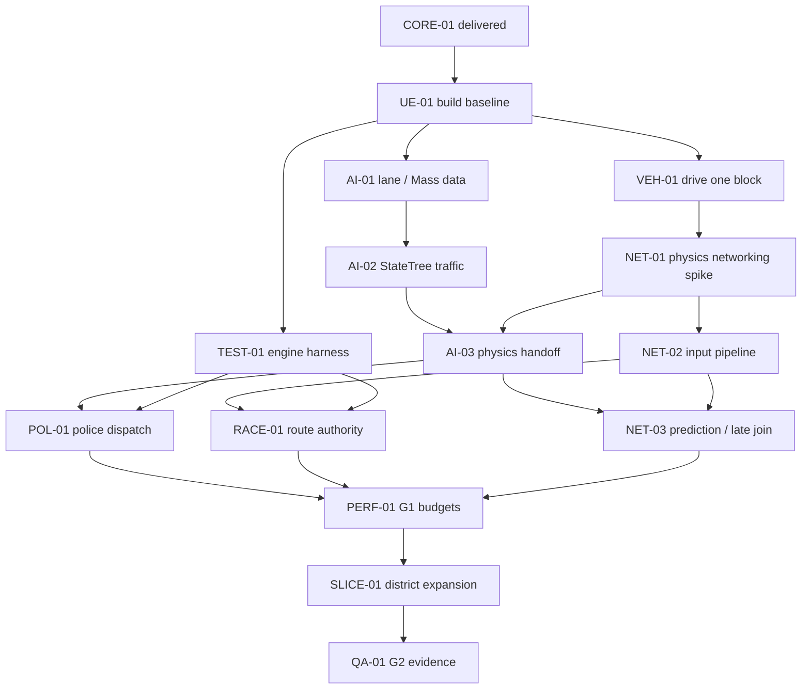

# Milestones and assignable engineering tasks

Only `CORE-01` is complete. All other tasks are unstarted; authored UE scaffold
does not satisfy an engine acceptance gate. Sizes describe review scope, not
calendar estimates: S = one narrow change; M = a subsystem increment; L = a spike
that must produce a decision before follow-up implementation.

An importable [CSV copy](backlog.csv) contains the same 15 task entries, dependencies
and acceptance text. The Markdown is the canonical planning document.

## Dependency map

## G0 — portable foundation

### CORE-01 · Policy prototype · Complete · M

Delivered: core, headless scenario, 26 contract tests, verifier, trace and local
reports. ASan runtime did not start on this host; record that separately from
release/UBSan results. See `evidence/README.md`. No engine or network integration
credit is awarded by this task.

## G1 — engine walking skeleton

### UE-01 · Establish a pinned engine build · Unstarted · M

Dependencies: CORE-01. Touch: `unreal/`, integration runbook, licensed runner setup.
Confirm the exact UE 5.6 build/commit and supported compiler; inspect plugin/module
names and fix scaffold compatibility. Build Editor, Game and Server targets from
a clean checkout; add a blank graybox map and a replicated Actor containing the
pursuit component. Replace the temporary dropped-time policy clock.

Acceptance: UHT/UBT logs with exit codes; recorded engine build ID; packaged map
launch; server owns policy steps and a client cannot change severity. Record a
100 ms hitch test with policy-clock behavior. Attach logs and a short capture.
No Chaos car, Mass or playable-game claim is part of this PR.

### TEST-01 · Add engine scenario and artifact harness · Unstarted · M

Dependencies: UE-01. Touch: UE automation tests, scenario driver and report schema.
Run the same pursuit event vectors as the portable suite through the component.
Add map/engine/build/seed IDs, event ticks, raw trace paths and first-divergence
reporting. Add a dedicated-server two-client smoke runner; choose Gauntlet or an
explicit process supervisor and document its prerequisites.

Acceptance: exact policy transition comparison, server tick ownership assertion,
nonzero exit on intentional mismatch, captured logs on timeout/crash. Store real
reports outside source assets. Do not fabricate an engine pass from a mock run.

### VEH-01 · One Chaos car on one graybox block · Unstarted · M

Dependencies: UE-01. Touch: vehicle pawn, wheel setup, input, camera, asset manifest.
Use one original or properly licensed rig and explicit torque/suspension values.
Make acceleration, braking, steering and reset work. Add server-observable pose
and speed telemetry, not a full damage system.

Acceptance: drivable packaged client; five repeated 0–100 km/h/braking runs;
no NaN transform or explosive energy in a low-speed wall collision; handling
parameters and raw trace attached. Include asset provenance and distribution
rights. No external content may be committed without a manifest entry.

### NET-01 · Decide the networked physics strategy · Unstarted · L

Dependencies: VEH-01. Touch: disposable two-car test map, network configuration,
new ADR and test recordings. Compare default authoritative replication with
candidate owner resimulation and remote predictive interpolation on the pinned
engine. Test real client/server processes, not just PIE single-process playback.

Acceptance: 0/80/150 ms RTT, 0/1/3% loss, rear-end and side-impact scenarios;
record correction magnitude/frequency, server contacts and client presentation.
Recommend a concrete configuration or explicitly fail the spike. Include known
unsupported interactions. Do not introduce a full custom physics protocol here.

### AI-01 · Lane graph and Mass traffic data · Unstarted · M

Dependencies: UE-01. Touch: lane data, Mass fragments, occupancy processors, tests.
Create a hand-authored four-way junction and eight logical traffic entities;
separate desired speed, lane position, reservation and representation data.
Implement stable IDs and lane-sorted leader lookup with explicit units.

Acceptance: fixed seeds reproduce route/decision events; 20 agents preserve
nonnegative gaps and stable IDs without any Chaos Actors. Assert bounds and
deferred entity changes; attach processor cost trace. No city generator.

### AI-02 · StateTree traffic decisions and reservations · Unstarted · M

Dependencies: AI-01. Touch: FollowLane / Yield / Stop / Recover tasks and assets.
Use shared junction reservations ordered by request tick then logical ID. Add
timeout and reservation release for blocked vehicles.

Acceptance: two crossing streams, red-light stopping, green restart, stalled
leader recovery, reservation mutual exclusion and no leaked reservations over
10-minute seeded runs. Include StateTree assets and test logs. These tasks must
not write Chaos transforms directly.

### AI-03 · Implement capped kinematic/Chaos handoff · Unstarted · L

Dependencies: AI-02, NET-01. Touch: pooled Actors, representation epochs and bridge.
Implement 50/70 m hysteresis and an eight-traffic-Actor global cap. Preserve IDs,
pose and velocity; forbid demotion during active contact. Instrument writer count.

Acceptance: 100 repeated promotions/demotions, moving-player boundary oscillation,
pool exhaustion and disconnect; zero duplicate pose writers or duplicate bodies;
provisional handoff discontinuity <= 10 cm and <= 0.5 m/s with raw traces.
Fail visibly if projection to a valid lane is impossible; do not teleport silently.

### NET-02 · Bounded server input, ownership and ACKs · Unstarted · M

Dependencies: NET-01. Touch: owned input submission, frame buffer, decoder and tests.
Replace the portable strict one-tick mailbox at the UE boundary. Specify epoch,
sequence, deadline, small redundancy window, rate cap, missing-input fallback and
processed-input ACK. Separate command acceptance from client movement prediction.

Acceptance: malformed lengths/ranges, wrong owner, old epoch, duplicates, reorder,
future-frame spam, 100% loss and reconnect all preserve bounded memory and server
authority. Late input follows the selected deadline policy and increments counters.
Attach actual network impairment logs; input flood causes no more physics steps.

### NET-03 · Owner correction, remote smoothing and late join · Unstarted · L

Dependencies: NET-02, AI-03. Touch: history buffer, chosen UE network physics mode,
remote presentation and relevant-state baseline. Use the NET-01 decision rather
than simultaneously building competing prediction systems.

Acceptance: collision matrix in TEST_PLAN.md meets correction gates; final race
and pursuit state match on all clients; late join receives the current state in
2 s after connection readiness; old-epoch packets cannot revive despawned Actors.
Record bytes/s and history allocation. Any unmet gate is a reported blocker.

### POL-01 · Server perception, dispatch and police unit behavior · Unstarted · M

Dependencies: AI-03, TEST-01. Touch: event IDs, perception bridge, dispatcher,
police StateTrees. Reuse core heat policy. Add 1/2/4 unit limits for heat 1/2/3,
last-known-position search and simple legal lane interception; G1 uses one unit.

Acceptance: acquire, lose, search, reacquire and clear scenarios; no duplicate
incident after physics replay; server-only spawns; unit cap survives disconnect
and destroyed unit replacement. Replicated heat matches the core event oracle.
Do not add weapons, helicopters or cinematic takedowns.

### RACE-01 · Server checkpoint race and reset semantics · Unstarted · M

Dependencies: NET-02, TEST-01, VEH-01. Touch: swept checkpoint validation, route,
server finish timer and minimal HUD. Add one short ordered route on the block.

Acceptance: forward crossings count once, reverse/out-of-order crossings fail,
fast travel through a volume is detected, reset applies a defined penalty and
clients cannot award progress. Two clients agree on server finish order under
150 ms RTT/3% loss. Attach server/client event logs.

### PERF-01 · Close G1 integration budgets · Unstarted · M

Dependencies: NET-03, POL-01, RACE-01. Touch: telemetry, stress profiles and report.
Use 2 clients, 8 traffic entities, one police unit, one block. Measure the complete
pipeline, annotate costs and remove avoidable allocations. Record both successes
and failures against the budgets in TEST_PLAN.md.

Acceptance: 10-minute repeatable Insights/network capture, declared hardware,
engine build and p50/p95/p99; all G1 correctness gates pass. No unexplained hitches
or unbounded queues. Expand content only after this task is accepted.

## G2 — constrained vertical slice

### SLICE-01 · Expand within explicit caps · Unstarted · M

Dependencies: PERF-01. Touch: hand-authored district, route, data presets, caps.
Expand to 1 km², three handling presets on one rig, 20 total traffic entities,
at most 8 traffic Chaos Actors, up to 4 police and 4 player cars. Keep one race,
dry daytime and session-local state. Capture representation counts continuously.

Acceptance: freely drive across the district; packaged client/server launch;
asset provenance complete; caps hold with players spread apart; no streaming
hole, checkpoint loss or police duplication. Re-run full budget captures at the
expanded load. If caps fail, apply the documented cut order.

### QA-01 · Produce the shareable vertical-slice evidence · Unstarted · M

Dependencies: SLICE-01. Touch: packaged builds, scenario reports and release notes.
Run the four-client latency matrix, crash scenarios, 30-minute soak and final
10-minute performance capture on declared reference hardware.

Acceptance: all required gates in TEST_PLAN.md pass, or the milestone remains
incomplete with explicit failures. Deliver exact build IDs, raw logs/traces,
command lines, recording, known limitations and a revised status ledger. A demo
video alone cannot close this task.

## Handoff contract for every task

One focused PR per task, with changed files, dependency checks, executable
acceptance evidence and remaining limitations. Split an L spike into experiment
and implementation PRs after its decision. Never mark dependent tasks complete
because a mock or unrelated portable test passed. See [DEVIN_START_HERE.md](DEVIN_START_HERE.md)
and the reusable issue template in `.github/ISSUE_TEMPLATE/engineering_task.yml`.
